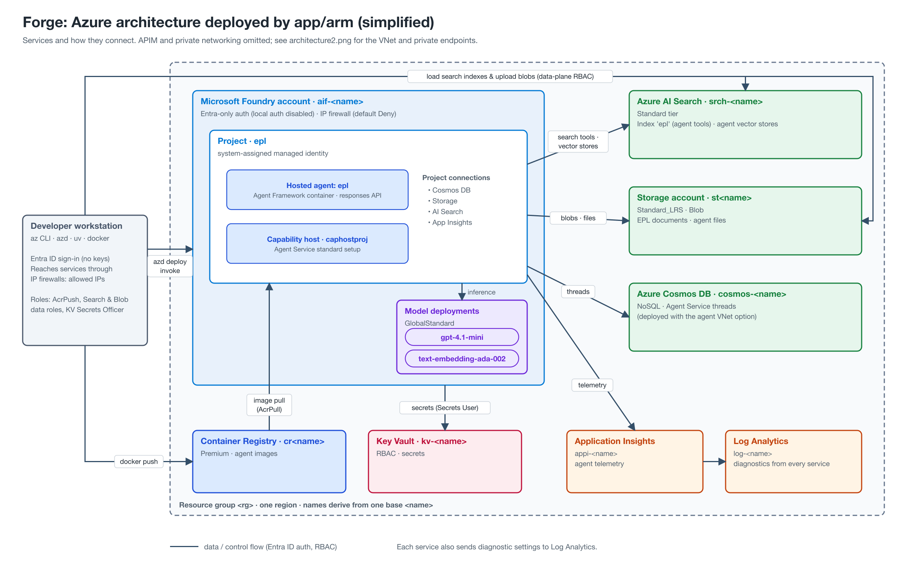
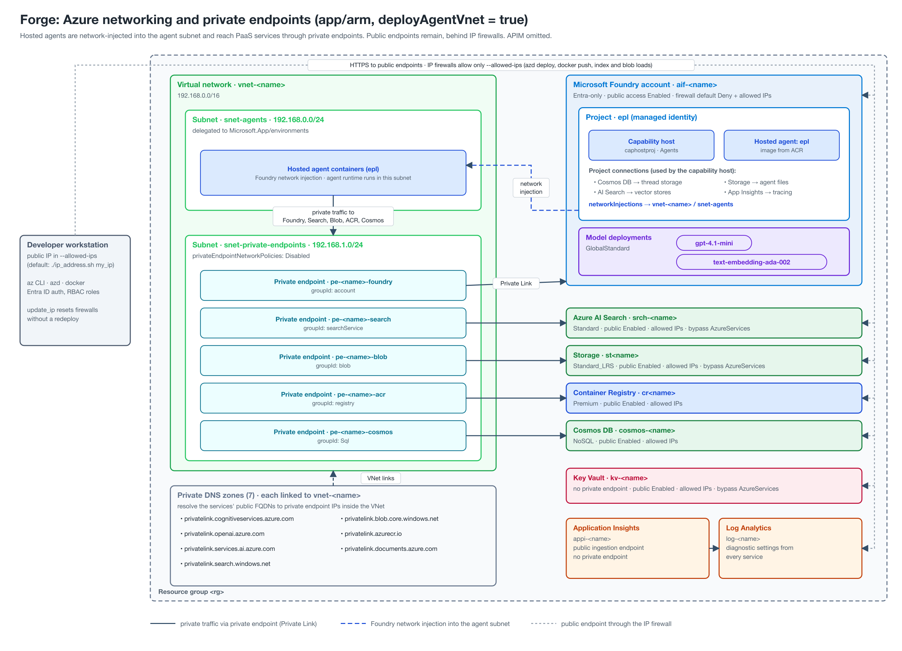
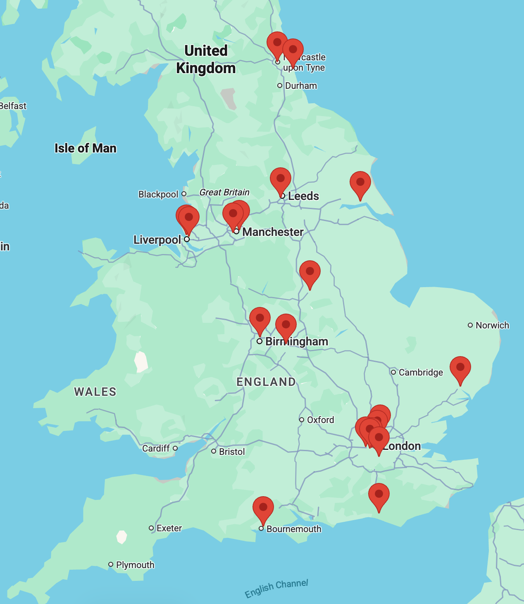
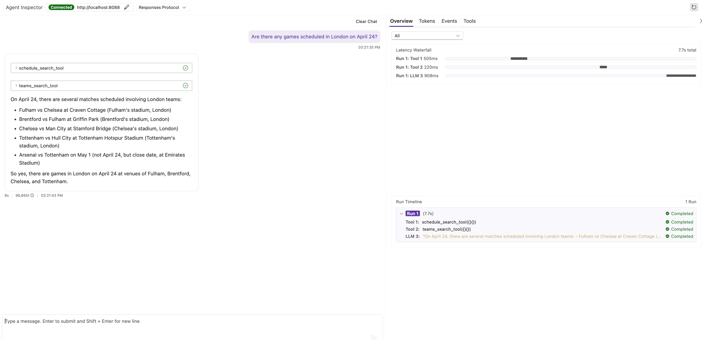
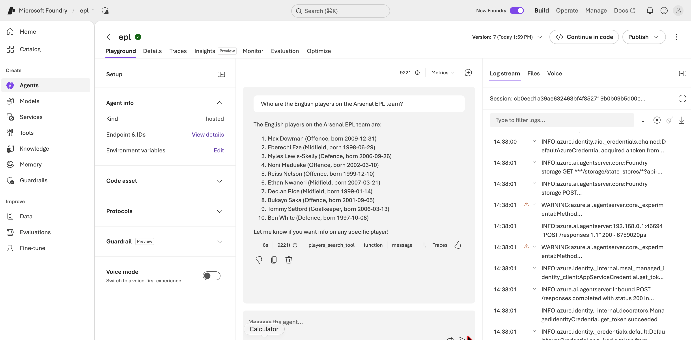
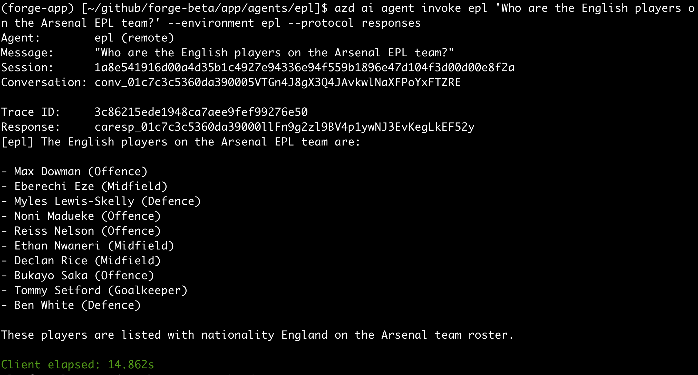

# Forge

## Purpose 

**Forge is a Foundry-Centric AI Reference Application** with reusable code,
scripts, and a curated set of data.

---

## Design Goals and Principles 

- Provide the **simplest possible implementation of a "Foundry-centric real-world pro-code AI Application"** 
  - Realize that each customer application is unique; strive for an 80/20 generic solution
  - Implement an ARM-based DevOps Deployable "Sandbox" environment, which includes:
    - Microsoft Foundry
    - Microsoft Foundry Project named "epl", with the English Premier League Reference application
    - Two LLM deployments in the Foundry Project for vectorization and completions
    - Azure Container Registry (ACR) for the Docker-containerized Agents
    - Azure Key Vault (AKV)
    - Azure Data Services per standard Foundry deployment
      - Azure Storage 
      - Azure AI Search for both general-search and vector/semantic search
      - Azure Cosmos DB for tememetry and memory, optionally for application data and vectors
    - Azure App Insights for Telemetry
    - Azure Monitor for Telemetry collection, reporting, and alerts
    - Azure firewall for IP-based Network Security
    - Azure private endpoints for service-to-service communication
- Focus on the **Microsoft and Azure Tech Stacks**
  - For example, use the **Agent Framework** rather than LangChain
- Focus on **"Pro-Code"**, primarily with Python, rather than "Low-Code"
  - However, simple YAML-based Agents and deployment scripts are provided
- Strive to implement **Best Practices** in the deployment and reference application
  - Use **Entra authentication** rather than keys throughout the application
  - Implement **IP address firewalls** throughout
  - Implement **observability** throughout the application
- Provide a simple, deployable, and relatable **Reference Application**
  - Not a "hello world" application
- The Accelerator should require a minimal learning curve
  - A goal is to make the reference application deployable in under one day
  - Provide documentation for an effective quick-start and use of this accelerator
  - Provide a limited set of reusable core Python classes where appropriate
  - Provide the necessary bash and PowerShell scripts to deploy and use the accelerator

---

## Implementation

- The solution is implemented with **Python 3** and the **uv** package manager
  - **uv** is used by Microsoft for their Python SDKs, and is an emerging python tool
  - A **pyproject.toml** file defines the project dependencies
  - See app/pyproject.toml
- This solution uses the **azd CLI tool** for rapid development
  - Azd enables a productive Developer workflow for Foundry based Agents
  - See https://learn.microsoft.com/en-us/azure/foundry/agents/concepts/cli-agent-development
  - See scripts app/demo.ps1 app/agents/epl/deploy.ps1 for examples of azd commands 
- This solution uses the **az CLI tool** for various ad-hoc Azure configuration purpose
- **ARM (Azure Resource Manager)** deployment script(s) for automated DevOps-enabled deployments
  - See the app/arm/ directory
- **Docker containerization and deployment** is preferred rather than code/zip files
  - Containerization aligns with customer DevOps pipelines, such as with Azure DevOps (ADO)
  - However, a working DevOps pipeline is currently out-of-scope for the accelerator
  - Docker enables deployment to an array of Microsoft PaaS services - Foundry, AppService, AKS, ACI
  - See app/agents/epl/deploy.ps1
- Solution includes a **custom code-generator** to generate deployable code and artifacts
  - The generated code/artifacts are **"azd friendly"** - usable by that CLI tool
  - See app/main-generator.py, the app/templates/ directory, and app/src/util/agent_generator.py

---

## Architecture Diagrams

The ARM-deployed Forge Resource Group looks like the following.





---

## Documentation

**Recommendation: Please first read ALL of the documentation below to better understand Forge.  Then deploy it.**

- 1. [Getting Started](docs/getting_started.md)
- 2. [Deployment](docs/deployment.md)
- 3. [Post-Deployment](docs/post-deployment.md)
- 4. [Use the Reference App](docs/reference-app.md)
- 5. [AI Development and Deployment](docs/ai-development.md)

---

## GitHub Repository Directory Structure

```
Directory Path                     Contents
------------------------           -------------------------------------
├── app                            Reference Application
│   ├── agents                     Deployable Foundry Agents
│   │   ├── epl                    EPL reference application python-based Docker-deployed Agent
│   │   └── python-stdlib          Sample YAML-based Agent related to the Python Standard Library
│   ├── arm                        Azure Resource Manager (ARM) scripts and deployment files            
│   ├── config
│   │   ├── cosmos                 Azure Cosmos DB configuration files
│   │   └── search                 Azure AI Search configuration files
│   ├── .env                       Master environment variables file for your deployment, git-ignored    
│   ├── dotenv-example             Example .env file for your reference   
│   ├── main-xxx.py                Python scripts for CLI execution in the app/ directory
│   ├── main-generator.py          Agent code generator
│   ├── generator_config.json      Config file used by the Agent code generator
│   ├── xxx.sh                     Supporting Bash scripts for macOS and Linux  
│   ├── xxx.ps1                    Corresponding PowerShell scripts for use on Windows 11  
│   ├── pyproject.toml             Python project configuration file.  Used by uv.  Similar to requirements.txt w/pip.
│   ├── src                        Reusable object-oriented Python source code
│   │   ├── ai                     Clases AISearchUtil, FoundryUtil, FoundryModels, FoundryModelPricing, etc
│   │   ├── db                     Class CosmosNoSqlUtil
│   │   ├── dev                    Class CodebaseAuditUtil
│   │   ├── io                     Classes FS (filesystem), StorageUtil, ZipUtil
│   │   ├── os                     Classes Env (environment variables), System
│   │   └── util        
│   ├── tests                      Pytest unit tests
│   └── tmp                        Temporary directory, git-ignored
├── data                           The curated set of data for the reference application
│   ├── documents                  PDF docs for Foundry vector search
│   ├── epl                        Pre-vectorized documents for AI Search documents (and optionally Cosmos DB)
│   ├── foundry                    Datasets related to Foundry Models, not the EPL reference app
│   └── uk_football                EPL players, teams, stadiums, etc
│       └── csv
├── docs
│   ├── img                        Images
│   ├── presentations              PPTs, PDFs
├── prompts                        Prompts for AI tool such as Claude Code
└── wrangling                      Code used to obtain and wrangle the curated data; see web/readme.md
    └── web                        Local web server for the Google Map of England and EPL team locations. (2)
```

---

## The Reference Application : English Premier League (EPL) Football Teams

The **Reference Application** that is deployed relates to the 
**EPL - English Premier League (football/soccer)**.
This repo contains curated datasets that are deployed to Azure Search, and optionally
to Cosmos DB, in the post-deployment process.

See the **data/** directory of this repo, which contains Cities, Teams,
Players, Stadiums, and the EPL match schedule.  Where appropriate,
the data is pre-vectorized so that you don't need to do this yourself.

This Google map of England shows the location of the EPL teams.



### The EPL Agent 

The reference application includes the **EPL Agent** that can access this
data, via several **tools**, to answer questions about the English Premier League.
This Agent is implemented in Python with the Agent Framework, and is located
in the **app/agents/epl/** directory of this repository.

#### EPL Agent User Questions 

The epl Agent is intended to answer questions like the following:

- What teams are in the EPL?
  - answered by the teams_search_tool
  
- Who are the English players on the Arsenal EPL team?
  - answered by the custom players_search_tool

- Who does Arsenal play at home in November?
  - answered by the custom schedule_search_tool

- Are there any games scheduled in London on April 24?
  - answered by the custom schedule_search_tool and teams_search_tool
  
- Who are the goalkeepers for the teams in London?
  - answered by the custom teams_search_tool and players_search_tool tools
  
- What is the player nationality distribution for Arsenal?
  - answered by the custom players_search_tool

- What teams are geographically closest to Arsenal?
  - answered by the custom teams_search_tool 

- How many games does each EPL team play?
  - answered by the custom teams_search_tool and schedule_search_tool

- Where is Coventry?
  - answered by the built-in web search tool 

- What is the result of: (5 * 5) * 100 - 3 
  - answered by the built-in code interpreter tool

Questions for a future version of Forge:

- What cities are most similar to Bristol?
  - Leverage the existing AI Search cities index w/vector search

Note: Arsenal is the team that won the last English Premier League (EPL) championship for the 2025–26 season.

### Python Standard Library Agent

Totally unrelated to the English Premier League, the reference applicaton
includes a simple YAML-based prompt agent.  It is located in is located in file
**app/agents/python-stdlib/azure.yaml** in this repository.

#### python-stdlib Agent User Questions 

The python-stdlib Agent is intended to answer questions like the following:

- How do I generate a globally unique identifier with python?
- How do I copy files with python?
- How do I execute a subprogram with python?

### Invoking the EPL Agent 

The following screen shots show three ways to do this:

#### In the Localhost Foundry Toollkit started by 'azd ai agent run epl --environment epl'



#### In the Foundry Portal Agent Playground



#### From the Localhost, invoking the remote Agent in Foundry with azd



---

## Forge Accelerator Roadmap

The initial V1 version of this accelelerator was completed in November 2026.

Future versions may include the following:

- Use Foundry to create Forge presentation content 
  - Text to speech 
    - https://learn.microsoft.com/en-us/azure/ai-services/speech-service/text-to-speech
  - Text to video 
    - https://learn.microsoft.com/en-us/training/modules/generate-video-with-foundry/

- Azure Cosmos DB as the application datastore 
  - Much richer data may be persisted in Cosmos.  AI Search is a flat search index rather than a DB.
  - DiskANN Vector Search is very fast and performant
  - Load the curated data in file **data/epl/merged_documents_v2.json** into an epl container 
  - Load the curated data in file **data/epl/cities_v2.json** into a cities container 
  - The following code and scripts are in a working state:
    - Indexing policy file app/config/cosmos/cosmosdb_nosql_vector_index_policy_diskann.json 
    - CLI program app/main-cosmos-nosql.py
    - Class CosmosNoSqlUtil ub app/src/db/cosmos_nosql_util.py
    - Utility scripts app/cosmos.sh and app/cosmos.ps1

- Telemetry Query Examples
  - KQL and other queries in Application Insights and Log Analytics 

- Azure API Management Integration 
  - APIM deployment is present in the current ARM deployment, but is disabled by default
  - Connections to Foundry/models/agents has not yet been implemented 
  - Consider integrating the other Accelerators (i.e. - Mike Torchia & Trevor Nims)

- Enhanced Agentic Functionality in the reference application
  - V1 only implements one Python Agent and one YAML prompt agent
  - Add MCP server(s)

- Foundry Local integration is a "nice to have"
  - However, I found that Foundry Local on macOS was essentially unusable
  - See https://github.com/microsoft/homebrew-foundrylocal/issues/31
